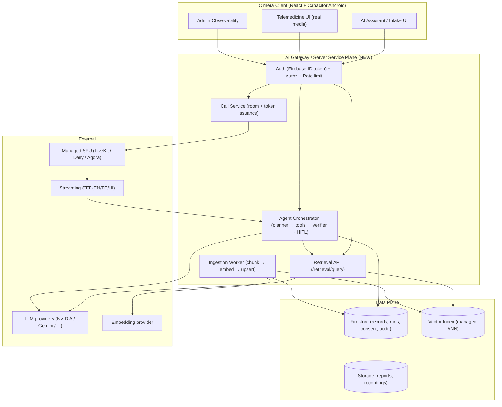
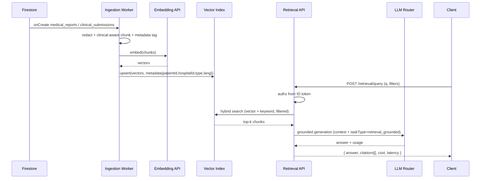
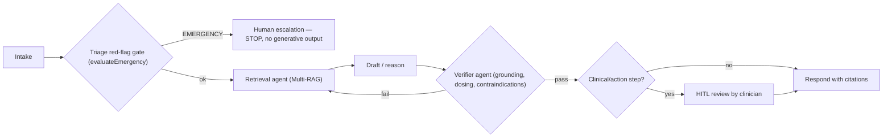

# Olmera Health Platform — Multi-RAG, Multi-Agent & Live Calling
## Technical Architecture Options, Implementation Roadmap & Feasibility Assessment

**Document type:** Engineering feasibility assessment & architecture proposal
**Scope:** Three capability groups — Multi-RAG (retrieval-augmented generation), Multi-Agent orchestration, Live Calling (real-time audio/video + streaming voice AI)
**Target application:** Olmera (repo `MediCare`), `com.olmera.app`
**Status:** For architecture review and approval
**Constraint framework:** No fabricated data; all findings reference the current codebase.

---

## 1. Executive Summary

Olmera is today a **React 18 + TypeScript + Vite single-page application** with a **client-side LLM routing layer** (`SmartLLMRouter`), **Firebase** (Auth / Firestore / Storage) as its data plane, and **Capacitor** packaging for Android. It already ships four *procedural* AI services (intake, triage, summarisation, report extraction), a **keyword-based pseudo-RAG** FAQ, and a **visual-only telemedicine screen**.

| Capability | What exists today | What the request implies | Feasibility |
|---|---|---|---|
| **Multi-RAG** | Keyword matcher `FAQ_KNOWLEDGE_BASE` in [assistantService.ts](file:///d:/Project/MediCare/src/services/ai/assistantService.ts), regex biomarker extraction in [reportExtractor.ts](file:///d:/Project/MediCare/src/services/ai/reportExtractor.ts). No embeddings, no vector store, no corpus pipeline. | Retrieval over patient records + clinical knowledge + reports, with citations, language-aware. | **Feasible.** No server tier exists; requires one (or a WASM/in-browser vector tier). |
| **Multi-Agent** | Single-shot, stateless prompt functions (`compileIntakeBriefWithLLM`, `analyzeReportWithLLM`, `processAssistantQuery`). Router with failover/cost/rate-limit accounting. | Planner/executor/critic/tool-using agents, shared memory, human-in-the-loop for clinical safety. | **Feasible**, but the current architecture is client-only and cannot host secure tool execution or shared memory reliably. |
| **Live Calling** | [TelemedicineUI.tsx](file:///d:/Project/MediCare/src/components/TelemedicineUI.tsx) is a **UI mockup**: static Unsplash images, `setInterval` timer, hard-coded "Doctor's Live Notes" and a hard-coded post-call summary. Voice I/O exists only as browser Web Speech API in [OlmeraAIAssistant.tsx](file:///d:/Project/MediCare/src/components/OlmeraAIAssistant.tsx). | Real WebRTC media, signalling, TURN, consent, recording, live transcription, mobile parity. | **Feasible with an external media/SFU partner.** Highest infrastructure delta of the three. |

### Single most important finding (blocker-level)

The LLM router reads provider secrets through **`VITE_`-prefixed variables** ([routerEngine.ts](file:///d:/Project/MediCare/src/services/ai/routing/routerEngine.ts#L84-L94)), which Vite **inlines into the client bundle**. Every browser user can extract the NVIDIA/Gemini keys. The `.env.example` *intends* these to be server-side (no `VITE_` prefix) and references a `/api/llm` endpoint **that does not exist in the repository**. Multi-RAG, Multi-Agent and Live Calling all *increase* key usage, cost exposure and PHI flow through this channel. **A server-side AI gateway must precede or accompany all three features.** This is elaborated in §6.1 and is treated as a cross-cutting prerequisite rather than a feature.

---

## 2. Baseline — Current State Assessment

### 2.1 Technology stack (verified)

| Layer | Technology | Evidence |
|---|---|---|
| UI | React 18.3, TypeScript 5.5, Tailwind 3.4, lucide-react, jspdf | [package.json](file:///d:/Project/MediCare/package.json#L25-L57) |
| Build | Vite 5 (`build` = `vite build && tsx scripts/prerender.ts`), single React plugin, **no dev proxy / no server middleware** | [vite.config.ts](file:///d:/Project/MediCare/vite.config.ts) |
| Mobile | Capacitor 8 (Android), splash/status-bar/haptics/keyboard | [capacitor.config.ts](file:///d:/Project/MediCare/capacitor.config.ts) |
| Data | Firebase Auth, Firestore, Storage (client SDK 12.19; `firebase-admin` 13.7 for scripts only) | [firebase.ts](file:///d:/Project/MediCare/src/lib/firebase.ts) |
| Supabase | **Disabled** — `export const supabase = {} as any;` | [supabase.ts](file:///d:/Project/MediCare/src/lib/supabase.ts) |
| AI | Hand-rolled multi-key/multi-provider router (NVIDIA NIM, Gemini, Anthropic, OpenAI-compatible, offline sim) | [routing/](file:///d:/Project/MediCare/src/services/ai/routing) |
| Auth/Security | PBKDF2 hashing, CSRF, rate limiting, magic-byte upload validation, authoritative pricing | [securityControls.ts](file:///d:/Project/MediCare/src/services/security/securityControls.ts) |
| Tests | Custom `tsx` runners (clinical / location / security / master-admin) + router validation suite | [package.json](file:///d:/Project/MediCare/package.json#L6-L11) |

### 2.2 AI layer as it exists today

- **Router** ([routerEngine.ts](file:///d:/Project/MediCare/src/services/ai/routing/routerEngine.ts)): singleton, priority tiers, four routing strategies (`priority_weighted`, `least_utilized`, `round_robin`, `cost_optimized`), 60 s cooldown on HTTP 429, `DEGRADED`/`QUOTA_EXHAUSTED` states, per-key sliding-window RPM/TPM, cost accounting, and `assertEnabledKeysAvailable()` which throws a fatal error if zero keys are enabled.
- **Providers** ([providerClients.ts](file:///d:/Project/MediCare/src/services/ai/routing/providerClients.ts)): direct `fetch` from the browser to each provider REST API. Note the Anthropic adapter sends `'dangerously-allow-browser': 'true'`.
- **Offline fallback**: `local-offline-fallback` simulation key lets the app run with no real provider (§§ routerEngine L160-L202), used by dev and tests.
- **Services** (single-shot, stateless): intake ([intakeAgent.ts](file:///d:/Project/MediCare/src/services/ai/intakeAgent.ts)), emergency triage, summariser, report extraction, prescription OCR/parser, assistant.

### 2.3 "RAG" and "agents" today are *not* what the request assumes

- **No vector retrieval anywhere.** Retrieval is: (a) substring keyword matching against a hard-coded `FAQ_KNOWLEDGE_BASE`, and (b) regex capture of biomarker names in free text.
- **No agent orchestration.** Each AI service builds one prompt, calls the router once, and returns. There is no planner, no tool registry, no loop, no shared state.
- **`reportExtractor.ts` contains a hard-coded fallback clinical panel** (Fasting Glucose 128, HbA1c 6.8, etc.) returned whenever no biomarkers parse. This contradicts the standing project constraint that hard-coded placeholder clinical values are prohibited, and it **must be remediated** before it is amplified by grounding logic (§6.4).
- **`TelemedicineUI` summary is hard-coded** ("Mild hypertension noted… 18:42") independent of any session.

### 2.4 Data & security plane

- Firestore rules ([firestore.rules](file:///d:/Project/MediCare/firestore.rules)) enforce owner/doctor/admin isolation for `patients`, `appointments`, `clinical_submissions`, `transactions`, `medical_reports`; `audit_logs` is append-only and immutable; unmatched collections default-deny.
- Uploads validated by magic bytes (JPG/PNG/PDF) and size in [securityControls.ts](file:///d:/Project/MediCare/src/services/security/securityControls.ts#L282-L324). Clinical files persist to IndexedDB + optional Firebase Storage via [clinicalStorage.ts](file:///d:/Project/MediCare/src/services/storage/clinicalStorage.ts).

### 2.5 Gap analysis vs. requested capabilities

| Dimension | Multi-RAG needs | Multi-Agent needs | Live Calling needs | Present today |
|---|---|---|---|---|
| Server compute tier | Ingestion + embedding + retrieval API | Orchestrator, tool sandbox, shared memory | Signalling + TURN/SFU + streaming STT | **None** |
| Secret handling | Server-held embedding/LLM keys | Server-held tool credentials | Short-lived media tokens | Client-inlined keys |
| Vector / search | Embedding index + ANN | Retrieval-attached memory | — | None |
| Real-time transport | — | — | WebRTC/SFU, WS | None |
| Async job infra | Batch ingest | Durable runs | Recording/transcode pipeline | None |
| Observability | Retrieval quality metrics | Trace/span per agent step | QoS (jitter/RTT/packet loss) | Router audit log only (100-entry ring) |

**Conclusion:** all three features share one missing architectural tier — a **server-side service plane** — which should be built once and reused, rather than solved three times inside the SPA.

---

## 3. Feature 1 — Multi-RAG

**Definition:** retrieval-augmented generation across *multiple heterogeneous corpora* (clinical knowledge base, per-patient longitudinal record, uploaded reports, medication/prescription history, operational content such as hospital/department catalogues), with source attribution, language awareness (EN/TE/HI) and strict per-tenant/per-patient isolation.

### 3.1 Architecture options

**Option A — In-browser vector RAG (WASM/WebGPU).**
Embeddings via a quantised ONNX model (`transformers.js`) running in a worker; vectors stored in IndexedDB; cosine search in JS/WebGPU.
- Pros: no server; zero new infra; offline-capable (aligns with the existing `local-offline-fallback` philosophy and Capacitor packaging).
- Cons: model download size; weak mobile GPU coverage; **cannot index server-held PHI without first downloading it to the device** (privacy regression); no shared corpus across users/devices.

**Option B — Firestore-native retrieval.**
Store chunked text + a generated embedding array on the document; retrieve candidates by Firestore query, then re-rank client/server-side.
- Pros: reuses the existing data plane and rules; minimal new services.
- Cons: Firestore has **no native vector index / ANN** — cosine similarity requires reading candidate docs, which is not viable at corpus scale and multiplies PHI reads.

**Option C — Managed vector store + server retrieval API (recommended core).**
A Cloud Functions (or equivalent) **AI gateway** exposes `POST /retrieval/query`. Ingestion pipeline chunks + embeds documents and upserts into a managed ANN index (**Firestore Vector Search / Vertex AI Vector Search / pgvector / Pinecone — pick per procurement**). Metadata filters enforce `hospitalId`/`patientId`/`role`.
- Pros: correct isolation, scales, server-held keys, supports hybrid (BM25 + vector) ranking and re-ranking, natural place for citations and audit.
- Cons: introduces the server tier (needed anyway) and per-query cost.

**Option D — Vendor RAG engine (Vertex AI RAG Engine / Bedrock KB).**
Fully managed ingestion + retrieval + grounding.
- Pros: fastest path to grounded answers; built-in citations.
- Cons: vendor lock-in, PHI residency/data-processing review, coarser control over multilingual clinical chunking; still requires the gateway for authz.

### 3.2 Recommended architecture

**Hybrid: Option C as the backbone + Option A as degraded/offline mode.**
- Server retrieval is authoritative (privacy, scale, isolation).
- When the gateway is unreachable (offline mobile, dev), fall back to a **small approved** in-browser corpus (public patient-education content only — never PHI), mirroring the existing "degrade gracefully" pattern used by the router.

### 3.3 Component requirements

| Component | Responsibility | Reuse / new |
|---|---|---|
| Ingestion worker | Chunking (clinical-aware: by section/biomarker), metadata tagging (patient, hospital, doc type, language, effective date) | New |
| Embedding client | Batched embeddings, retry, cost meter (extend `RouterSystemHealth` accounting) | New |
| Vector index | ANN store with metadata filters | New (managed) |
| Retrieval API | Authz-scoped query, hybrid rank + re-rank, citation assembly | New (server) |
| Grounded-generation adapter | Wrap `SmartLLMRouter.completePrompt` with retrieved context + citation contract | Extend [routerEngine.ts](file:///d:/Project/MediCare/src/services/ai/routing/routerEngine.ts) |
| Corpus governance | Approved vs. patient-derived corpus separation; redaction; retention | New |
| UI citations | Render `sourceCitations` (field already exists on `AssistantMessage`) | Extend [assistantService.ts](file:///d:/Project/MediCare/src/services/ai/assistantService.ts#L23) |

### 3.4 Integration patterns

- Replace the `FAQ_KNOWLEDGE_BASE` loop in [assistantService.ts](file:///d:/Project/MediCare/src/services/ai/assistantService.ts#L127-L142) with a `retrieve()` call; keep the emergency-triage gate as the **first** step (safety ordering must not change).
- Feed retrieval results into existing services: `analyzeReportWithLLM`, `compileIntakeBriefWithLLM`, and the summariser gain a `retrievedContext` parameter rather than new entry points.
- Ingestion is **event-driven**: Firestore `onCreate` for `medical_reports` and clinical submissions triggers chunk+embed; destroyed files trigger index deletion (cascade integrity).

### 3.5 Performance considerations

- **Latency budget:** target retrieval ≤ 300 ms p95 (vector) + ≤ 150 ms re-rank; total grounded answer ≤ 3 s p95 server-side, excluding provider latency already measured by the router.
- **Chunking:** 400–800 token windows with 15% overlap; clinical sections never split mid-table (protects biomarker semantics).
- **Cost:** embedding is one-time per document version; cache embeddings by content hash to avoid re-embedding on re-upload.
- **Isolation cost:** every query must carry tenant/patient filters at the index layer, not in post-processing, to prevent cross-tenant leakage and wasted reads.
- **Mobile:** prefer server retrieval on mobile (avoid model download + battery); browser RAG only when offline.

### 3.6 Compatibility requirements

- **No change** to the existing router interface is required if grounding is injected as prompt context; recommended the router gains a `taskType: 'retrieval_grounded'` value (currently `chat | clinical_summary | prescription_ocr | emergency_triage`).
- Must honour Firestore rules semantics ([firestore.rules](file:///d:/Project/MediCare/firestore.rules)) — server retrieval re-implements equivalent authz and must be tested against the same role matrix.
- Multilingual: embeddings must support TE/HI; store `language` metadata and filter or translate per `AssistantLanguage`.

### 3.7 Implementation steps

1. Stand up the AI gateway (shared with §4/§5) with authz + request signing.
2. Define corpus taxonomy: `approved_clinical`, `patient_record`, `report_extract`, `operational`; define redaction rules.
3. Build ingestion worker (chunk → embed → upsert) + Firestore triggers; backfill existing `medical_reports` via a `tsx` script alongside existing seed scripts.
4. Implement `POST /retrieval/query` with hybrid ranking + metadata filters + citation output.
5. Add grounded-generation adapter in the router; introduce `retrieval_grounded` task type.
6. Wire `assistantService` / `reportExtractor` / `intakeAgent` to consume retrieval; render citations.
7. Add the browser-side degraded corpus (approved content only).
8. **Remediate** the hard-coded fallback panel in [reportExtractor.ts](file:///d:/Project/MediCare/src/services/ai/reportExtractor.ts#L178-L223) to a "no parseable data" state.

### 3.8 Dependencies

- Server tier: Cloud Functions (or Node service) + a managed vector index.
- Optional client: `@xenova/transformers` (or `@huggingface/transformers`) for degraded browser RAG.
- Embedding provider (can be Gemini or an OpenAI-compatible embedding endpoint via the existing provider abstraction).
- No new UI library required.

### 3.9 Testing methodology

- **Unit (tsx runner):** extend the existing test suite pattern (e.g. `runRetrievalTests.ts`) — chunk boundary correctness, metadata filter enforcement, citation presence.
- **Isolation tests:** assert that a query as patient A can never return patient B chunks (mirror `runSecurityTests.ts` style).
- **Retrieval quality:** golden set of Q→expected-source pairs; measure Recall@k, nDCG, and *groundedness* (answer supported by cited chunks).
- **Regression:** ensure emergency-triage gate still precedes retrieval.
- **Cost/latency:** instrument p50/p95 retrieval and embed cost; assert budgets in CI.

### 3.10 Success criteria

- Cross-tenant/cross-patient leakage: **0** in isolation suite.
- Recall@5 ≥ 0.85 on the golden clinical Q set; groundedness ≥ 0.9 judged by rubric.
- p95 retrieval ≤ 300 ms; grounded answer p95 ≤ 3 s (ex-provider).
- 100% of grounded responses display ≥1 citation; uploaded reports retrievable within one ingestion cycle.

---

## 4. Feature 2 — Multi-Agent

**Definition:** an orchestrated set of specialised agents (e.g. Intake, Triage, Retrieval, Summariser, Scheduling, Billing, Critic/Verifier) that plan, call tools, share memory, and escalate to a human clinician — replacing today's one-shot prompt functions.

### 4.1 Architecture options

**Option A — In-process orchestrator (client).**
A planner/executor loop inside the SPA using `SmartLLMRouter`.
- Pros: reuses the router; no infra.
- Cons: **unsafe** — tool credentials, PHI aggregation and durable state would live in the browser; no reliable retries; not auditable to clinical standard.

**Option B — Server orchestrator, in-repo graph.**
Cloud Function hosts a state machine/agent graph (planner → tool nodes → verifier → responder) with tool sandboxing and persistent run state.
- Pros: secure, auditable, reuses router abstraction server-side; supports human-in-the-loop checkpoints.
- Cons: build effort; long-running runs need a durable store.

**Option C — Framework-based orchestration (LangGraph / AutoGen / CrewAI on the server).**
- Pros: mature patterns for state, cycles, HITL, checkpointing.
- Cons: heavy dependency; must be adapted to the router and Firestore; framework churn.

**Option D — Cloud-native agent runtime (e.g. managed agent service).**
- Pros: least orchestration code, built-in tracing.
- Cons: lock-in; PHI/vendor review; less control over clinical guardrails.

### 4.2 Recommended architecture

**Option B first (a thin, explicit, testable graph), with Option C as an accelerator only if the graph complexity justifies it.** Given the clinical-safety requirement and the existing house style (explicit, dependency-light, heavily tested code), an explicit graph is preferable to a framework black box.

Core graph:

```
intake → triage(red-flag gate) → [EMERGENCY → human escalation, STOP]
                               → retrieve (Multi-RAG) → reason/draft
                               → verify (critic: grounding, dosing, contraindication)
                               → [low confidence OR clinical action → HITL review]
                               → respond (with citations)
```

### 4.3 Component requirements

| Component | Responsibility |
|---|---|
| Agent registry | Declarative agent definitions (role, prompt, allowed tools, model class) |
| Orchestrator | Deterministic state machine, retries, timeouts, checkpointing |
| Tool layer | Typed, allow-listed tools (retrieve, schedule, pricing via `verifyTransactionPricing`, FHIR read) |
| Memory | Short-term (run) + long-term (patient summary), retrieval-attached |
| Guardrails | Red-flag gate (reuse `evaluateEmergency`), prescription/contraindication checks, output schema validation |
| HITL gate | Human approval for any clinical/action step before effect |
| Tracer | Per-step spans, model, tokens, cost, tool I/O — extend the router audit concept |
| Verifier agent | Independent critic pass; block unsupported claims |

### 4.4 Integration patterns

- Keep `SmartLLMRouter` as the **model gateway**; each agent step is a `completePrompt` call with a distinct `systemInstruction` and `taskType`.
- Reuse `evaluateEmergency` as an **unconditional** first node (safety invariant already established in [assistantService.ts](file:///d:/Project/MediCare/src/services/ai/assistantService.ts#L99-L116)).
- Reuse `verifyTransactionPricing` as the Billing agent's only pricing source (never trust model output for money).
- Emit run records to a new `agent_runs` collection governed by rules equivalent to `audit_logs` (append-only).
- UI: surface agent progress/steps where a user-facing run exists (e.g. intake), otherwise run headless.

### 4.5 Performance considerations

- **Fan-out control:** cap parallel tool calls; retrieval and reasoning steps can run concurrently, verification must be sequential after draft.
- **Token/cost:** the router already tracks per-key cost; extend to per-run cost ceiling with hard abort.
- **Timeouts:** per-step timeout + overall run budget; degrade to a safe templated answer (existing pattern: static fallbacks).
- **Caching:** memoise retrieval within a run; cache patient summary between steps.
- **Concurrency:** Firestore + Functions concurrency limits must be sized for the worst-case run (longest chain × parallel users).

### 4.6 Compatibility requirements

- Entirely additive to the router interface; add `taskType` values and an optional `agentId`/`runId` for tracing.
- Must respect the same RBAC matrix as the app (`role`/`hospitalId` from auth context) and Firestore rules.
- Clinical guardrail: no agent may take an irreversible clinical action without HITL, consistent with `clinical_submissions` approval gating in [firestore.rules](file:///d:/Project/MediCare/firestore.rules#L93-L102).
- Mobile: runs are server-side; the Capacitor client only displays status — no new native plugins.

### 4.7 Implementation steps

1. Define the agent registry schema and the initial five agents (Intake, Triage, Retrieval, Summariser, Verifier).
2. Implement the orchestrator (state machine + run store + tracer) in the gateway.
3. Implement the tool layer with a strict allow-list and typed I/O; wire retrieval (§3), scheduling, pricing.
4. Add the HITL checkpoint and run persistence.
5. Port existing services (`intakeAgent`, `patientSummarizer`) to run **through** the graph, keeping their public APIs stable.
6. Add per-run cost ceiling and safe-degradation fallbacks.
7. Build an admin run-inspector view (reuse the `LLMRouterDashboard` observability pattern).

### 4.8 Dependencies

- Server tier from §3 (shared).
- Durable run store (Firestore collection or equivalent).
- Optional: a tracing backend (OpenTelemetry-compatible) — recommended, not required.
- No framework strictly required.

### 4.9 Testing methodology

- **Determinism harness:** stub model responses to replay the graph; assert node order, guardrail invocation, HITL triggering.
- **LangGraph-style scenario tests** implemented as tsx assertions: emergency input ⇒ escalation node and no generative output; low-confidence ⇒ HITL.
- **Safety tests:** verifier must block unsupported/dosing claims on a curated adversarial set (extends `runSecurityTests.ts`).
- **Chaos:** inject provider 429/5xx (router already models these) and assert failover/degradation, not crashes.
- **Cost tests:** assert run aborts at ceiling.

### 4.10 Success criteria

- 100% of emergency-flag inputs route to escalation with **zero** generative clinical output.
- Verifier blocks ≥ 95% of seeded unsupported clinical claims.
- Every clinical/action step passes through HITL (audited: **0** unattended clinical actions).
- p95 end-to-end intake run ≤ 6 s ex-provider; per-run cost ≤ configured ceiling with hard abort verified.
- Zero regressions in existing `runClinicalTests.ts` / `runMasterAdminTests.ts`.

---

## 5. Feature 3 — Live Calling

**Definition:** real bidirectional audio/video consultation between patient and clinician, with consent capture, in-call document sharing (already designed in the UI), optional recording, and **live transcription/voice AI** extending the existing Web Speech pipeline — cross-platform on web and Capacitor Android.

### 5.1 Current gap (explicit)

[TelemedicineUI.tsx](file:///d:/Project/MediCare/src/components/TelemedicineUI.tsx) has **no media transport**: doctor/patient "video" are Unsplash images; the timer is `setInterval`; "Doctor's Live Notes" and the post-call summary are hard-coded. Real calling is a **net-new build**, not an extension.

### 5.2 Architecture options

**Option A — Peer-to-peer WebRTC mesh** with Firebase for signalling (Firestore/RTDB) + self-hosted TURN (`coturn`).
- Pros: cheapest per-minute; full control; reuses Firebase.
- Cons: N² scaling, unreliable on restrictive mobile networks without good TURN, you own all reliability/recording/transcoding; poor fit for group/clinician-panel scenarios.

**Option B — SFU via a managed platform (LiveKit / Daily / Agora / Twilio Video).**
- Pros: production reliability, TURN included, simulcast, server-side recording, egress, mobile SDKs, transcription add-ons; fastest to a *reliable* product.
- Cons: per-minute cost; vendor dependency; PHI/data-processing agreement required.

**Option C — Managed telehealth SDK (e.g. Doxy.me-style or Twilio Programmable Video + Flex).**
- Pros: compliance packaging, waiting rooms, willingness-to-pay flows.
- Cons: highest cost; least control; broadest lock-in.

### 5.3 Recommended architecture

**Option B (managed SFU) behind an abstraction layer, with Option A's signalling concepts understood as fallback.** Rationale: clinical calls are high-consequence; reliability and call-quality telemetry outweigh marginal per-minute savings, and the abstraction layer keeps Option A/C viable later.

```
Client (web / Capacitor Android)
  │  join consult
  ▼
AI Gateway / Call Service  ── issues short-lived room+role token (server-held secret)
  │
  ├─► SFU (managed)  ── audio/video/screen, simulcast, TURN
  ├─► Signaling/room state  (SFU-native or Firestore)
  ├─► Recording egress  ── encrypted, retention-governed, into Storage
  └─► Streaming STT  ── live transcript → (Multi-Agent) summariser → post-call note
```

### 5.4 Component requirements

| Component | Responsibility |
|---|---|
| Call service | Room lifecycle, participant roles, token issuance, join/leave audit |
| Media SDK | Web + Capacitor integration; device/permission handling |
| Consent capture | Pre-call recording/transcription consent; persisted, versioned |
| Live transcription | Streaming STT (EN/TE/HI), speaker attribution, interim results |
| Recording pipeline | Encrypted egress, retention/TTL, access control |
| Quality telemetry | RTT, jitter, packet loss, MOS; surfaced to support |
| Device management | Camera/mic enumeration, switching, mute (UI already stubs this) |
| Post-call automation | Transcript → summary → HITL → note (ties into §3/§4) |

### 5.5 Integration patterns

- **Replace the mock** in `TelemedicineUI` incrementally: keep the existing checklist/upload/summary steps; swap the `step === 'call'` media block and the hard-coded summary for real stream + generated summary.
- Reuse [clinicalStorage.ts](file:///d:/Project/MediCare/src/services/storage/clinicalStorage.ts) patterns for in-call document sharing (already data-URL based) but prefer Storage-backed URLs for large files.
- Pre-call consent must be recorded before media starts; align with the existing `ConsentManagementModal`.
- Post-call note generation must run through the §4 graph with HITL — never auto-publish.
- Capacitor: inject the native media plugin (e.g. a WebRTC-capable plugin) at call start; request runtime permissions.
- Mobile background/foreground and audio-focus handling via existing Capacitor plugins ([App](file:///d:/Project/MediCare/src/App.tsx#L4) already used).

### 5.6 Performance considerations

- **Targets:** join success ≥ 99% p95; time-to-first-frame ≤ 2 s; audio latency ≤ 150 ms one-way; video ≤ 400 ms; call drop rate ≤ 1%.
- **Bandwidth adaptation:** simulcast + adaptive bitrate; degrade to audio-only on weak links (must be automatic).
- **Streaming STT:** use interim results for responsiveness; chunk to the summariser only on final segments; target transcript lag ≤ 1.5 s.
- **Recording:** server-side egress (not client) to avoid device-dependent quality/failures; encrypt at rest.
- **Mobile:** battery/thermal — cap resolution on battery saver; handle network handoff (Wi-Fi↔cellular) via ICE restart.

### 5.7 Compatibility requirements

- **Web:** Chrome/Edge/Firefox/Safari (WebRTC + secure context). Camera/mic require HTTPS.
- **Capacitor Android:** native media permissions in manifest; runtime grant; `androidScheme: 'https'` already set.
- **Firestore rules:** add consult-room + consent + recording-metadata collections with owner/doctor/admin authz, mirroring `appointments`.
- **No PHI in the media platform's metadata** beyond an opaque room id; keep clinical linkage in Firestore only.
- Encryption: DTLS-SRTP in transit (native to WebRTC); recording encrypted at rest with managed keys.

### 5.8 Implementation steps

1. Select and contract an SFU/platform; complete PHI/data-processing review.
2. Implement the **call service** in the gateway: token issuance, role mapping (from auth `role`), room lifecycle, join/leave audit to an append-only collection.
3. Integrate media SDK on web; replace the mock media block; wire mute/camera toggles to real tracks.
4. Add Capacitor native media plugin + permissions; verify on device.
5. Add pre-call **consent** capture (recording + transcription) with versioned persistence.
6. Add **streaming STT**; render live captions; route final transcript to the §4 summariser with HITL.
7. Add **recording** (server egress) with retention TTL + access control.
8. Add **quality telemetry** (RTT/jitter/loss) + support dashboard.
9. Replace the hard-coded post-call summary with the generated, HITL-approved note.

### 5.9 Dependencies

- Managed SFU SDK (e.g. LiveKit / Daily / Agora / Twilio — final choice is a procurement decision).
- Streaming STT provider (EN/TE/HI) — verify Telugu/Hindi accuracy, a hard requirement given the platform's language scope.
- Capacitor media/permission plugin; Android manifest permission changes.
- TURN (included with SFU, or `coturn` if Option A).
- Secret storage for platform keys (server only).

### 5.10 Testing methodology

- **Signalling unit tests:** token issuance enforces role/hospital authz; expired/forged tokens rejected.
- **Loopback media tests:** client-to-client in CI where feasible; otherwise scripted two-browser harness.
- **Network-condition tests:** throttle/loss/latency profiles; assert automatic audio-only degrade and ICE restart on handoff.
- **Mobile device matrix:** physical Android (Capacitor) permission grant/deny, backgrounding, audio focus.
- **Consent tests:** media cannot start without a recorded consent event (behavioural assertion).
- **Transcript tests:** multilingual accuracy sampling; summariser consumes only final segments.
- **Resilience:** SFU token expiry mid-call; reconnection; recording failure does not drop the call.

### 5.11 Success criteria

- Join success ≥ 99% p95; drop rate ≤ 1%; audio latency ≤ 150 ms one-way.
- **0** calls start without consent; **0** recordings accessible outside role scope.
- Transcript lag ≤ 1.5 s; post-call note always HITL-approved before persistence.
- Android call parity: full call flow on a physical device.
- Automatic audio-only degrade verified under a defined loss profile.

---

## 6. Cross-Cutting Concerns

### 6.1 Security & secret management (prerequisite)

- **Move all provider keys server-side.** Eliminate `VITE_`-prefixed provider secrets and the `dangerously-allow-browser` Anthropic header; route model calls through the AI gateway. Without this, all three features inherit a key-exfiltration and cost-abuse vulnerability.
- Gateway authenticates every request (Firebase ID token), performs authz, applies per-user rate limits (reuse `checkRateLimit` semantics server-side), and never returns provider keys.
- All new PHI-touching endpoints follow the `firestore.rules` role model (owner / doctor / admin / senior-doctor).

### 6.2 Privacy & compliance

- PHI residency and data-processing agreements for the vector store, SFU and STT vendors — a **gating review** before Feature 3 and before any server-side patient-record embedding.
- Consent for recording and transcription, versioned and auditable.
- Data minimisation: embeddings/transcripts tagged with opaque ids; raw media retention TTL.
- Append-only audit for retrieval queries, agent runs, and calls (mirror `audit_logs` immutability).

### 6.3 Observability

- Extend the existing router audit/log pattern to a unified trace: `{runId, step, agentId, model, tokens, cost, latency, tool, retrievalHits}`.
- Add QoS telemetry for calls.
- Build one admin observability surface (the `LLMRouterDashboard` is the existing template).

### 6.4 Data-integrity remediation (do first)

- Remove the hard-coded clinical fallback panel in [reportExtractor.ts](file:///d:/Project/MediCare/src/services/ai/reportExtractor.ts#L178-L223) and the hard-coded telemedicine summary; replace with explicit "no data" states. Grounding logic will otherwise amplify fabricated clinical values.

### 6.5 Cost governance

- Per-run and per-tenant cost ceilings with hard aborts; embedding cache by content hash; call-minute budgets; alerting on threshold breach (the router already exposes spend metrics to extend).

---

## 7. Architecture Diagrams

### 7.1 Target end-state



### 7.2 Multi-RAG ingestion & query



### 7.3 Multi-Agent run graph



### 7.4 Live calling

```mermaid
sequenceDiagram
  participant P as Patient client
  participant D as Doctor client
  participant CS as Call Service (gateway)
  participant SFU as Managed SFU
  participant STT as Streaming STT
  participant AG as Agent Orchestrator

  P->>CS: request join (Firebase ID token, consultId)
  D->>CS: request join
  CS->>CS: authz role + hospital; write join audit
  CS-->>P: short-lived room token
  CS-->>D: short-lived room token
  P->>CS: consent(record?, transcribe?) → persisted
  D->>CS: consent
  P->>SFU: connect + publish tracks
  D->>SFU: connect + subscribe
  SFU->>STT: media stream (final segments)
  STT-->>AG: transcript segments
  AG-->>CS: draft note (HITL pending)
  CS->>CS: encrypted recording egress (if consented)
  P->>CS: leave → finalise + retention TTL
```

---

## 8. Implementation Roadmap (milestone-sequenced)

> Sequenced by dependency and risk, **not** by calendar time. Each phase is independently shippable and testable.

**Phase 0 — Foundations (prerequisite for everything)**
- Stand up the AI Gateway; migrate provider keys server-side; remove `dangerously-allow-browser`.
- Auth/authz + per-user rate limiting + unified tracing skeleton.
- Remediate hard-coded clinical fallbacks (§6.4).

**Phase 1 — Multi-RAG core**
- Ingestion worker + vector index + `/retrieval/query` + grounded generation + citations.
- Wire assistant/report/intake; add isolation + quality tests.

**Phase 2 — Multi-Agent**
- Agent registry, orchestrator, tool allow-list, verifier, HITL, run store, admin inspector.
- Port intake & summariser through the graph; safety + determinism tests.

**Phase 3 — Live Calling (media)**
- SFU selection + compliance review; call service; web media integration; Capacitor parity; consent; quality telemetry.

**Phase 4 — Live Calling (intelligence) + convergence**
- Streaming STT; post-call note via Phase 2 graph with HITL; recording egress + retention.
- Converge: assistant uses RAG (§1) + graph (§2) + call transcripts (§3-4); single observability surface.

**Phase 5 — Hardening**
- Chaos tests, cost ceilings, load tests, security review, pen-test of new endpoints, mobile matrix sign-off.

---

## 9. Technical Feasibility Assessment

| Feature | Feasibility | Primary risk | Mitigation |
|---|---|---|---|
| **Multi-RAG** | **High** — well-understood; router abstraction already exists | PHI isolation + the missing server tier | Build gateway once (§0); index-level tenant filters; isolation test suite |
| **Multi-Agent** | **High** — additive to router; clear guardrail patterns already in code | Clinical safety of autonomous steps | Fail-closed red-flag gate; verifier; mandatory HITL; per-run cost abort |
| **Live Calling** | **Medium** — largest infrastructure delta | Vendor reliability, PHI/compliance, TE/HI STT accuracy | Managed SFU; compliance gating review; multilingual STT bake-off before commit |

**Overall: feasible**, conditional on investing in the shared server-side service plane first. Attempting any feature purely client-side repeats the existing key-exposure problem at greater scale and is **not recommended**.

### Risk register (top risks)

| # | Risk | Impact | Likelihood | Mitigation |
|---|---|---|---|---|
| R1 | Provider keys exposed client-side today | High | Certain (already true) | Phase 0 gateway migration |
| R2 | Cross-tenant PHI leakage via vectors | Critical | Medium | Index-layer filters + isolation tests |
| R3 | Hard-coded clinical data amplified by grounding | High | High (already present) | Phase 0 remediation |
| R4 | Unsafe autonomous clinical action | Critical | Medium | Verifier + HITL + fail-closed gate |
| R5 | Call quality on mobile networks | High | Medium | Managed SFU + TURN + audio-only degrade |
| R6 | TE/HI transcription accuracy | High | Medium | Multilingual STT bake-off pre-commit |
| R7 | Cost overrun (embedding, calls, tokens) | Medium | Medium | Per-run/tenant ceilings + alerting |
| R8 | Vendor lock-in (SFU/vector/STT) | Medium | Medium | Abstraction layers per capability |

---

## 10. Unified Testing Methodology

- **Unit / logic:** extend the existing tsx runners — add `runRetrievalTests.ts`, `runAgentGraphTests.ts`, `runCallServiceTests.ts` alongside `runClinicalTests.ts`, `runSecurityTests.ts`, `runLocationTests.ts`, `runMasterAdminTests.ts`; keep them wired into `npm test`.
- **Router suite:** reuse [validateRouter.ts](file:///d:/Project/MediCare/src/services/ai/routing/validateRouter.ts) for failover/cost/rate-limit invariant coverage of the new task types.
- **Integration:** gateway contract tests (authz, schema, citations), Firestore-rule parity tests.
- **End-to-end:** patient journey (intake → grounded answer → consult → HITL note) on web + Android device.
- **Non-functional:** latency/cost budgets asserted in CI; chaos (429/5xx, token expiry, network loss); security (isolation, token forgery, upload validation reuse).
- **Manual QA:** cross-browser + Android device matrix; accessibility (the platform already targets 44px+ targets and WCAG AA — hold new UI to the same bar).

---

## 11. Consolidated Success Criteria

| Area | Criterion |
|---|---|
| Security | 0 client-side provider secrets; 0 cross-tenant retrieval leaks; 0 unattended clinical actions |
| RAG | Recall@5 ≥ 0.85; groundedness ≥ 0.9; 100% cited answers; p95 retrieval ≤ 300 ms |
| Agents | 100% emergency inputs escalate with no generative output; verifier blocks ≥ 95% seeded unsafe claims; p95 intake run ≤ 6 s ex-provider |
| Calling | Join ≥ 99% p95; drop ≤ 1%; audio ≤ 150 ms one-way; 0 calls without consent; transcript lag ≤ 1.5 s |
| Stability | 0 regressions in existing test suites; graceful degradation verified under provider failure and offline |
| Cost | 100% of runs/calls within configured ceilings; hard-abort verified |

---

## 12. Expected Deliverables

**This assessment (produced):**
- Architecture option analysis per feature (options, trade-offs, recommendation) — §3–§5.
- Component, integration, performance and compatibility requirements — §3–§5.
- Architecture diagrams (end-state, RAG sequence, agent graph, call sequence) — §7.
- Implementation roadmap (phased, dependency-ordered) — §8.
- Technical feasibility assessment + risk register — §9.
- Unified testing methodology & success criteria — §10–§11.

**To be produced during execution (by phase):**
- Phase 0: AI Gateway design + secret-migration plan + threat model.
- Phase 1: Ingestion/retrieval service design doc; corpus taxonomy & redaction spec; retrieval test harness & golden set.
- Phase 2: Agent registry spec; orchestrator state machine + tool schemas; HITL workflow; run/trace schema.
- Phase 3: SFU selection & compliance memo; call-service API spec; consent & recording policy; Android permission plan.
- Phase 4: Streaming STT integration spec; post-call note workflow; converged observability dashboard.
- Phase 5: Load/chaos test plan and results; security review & pen-test report; device-matrix sign-off.

---

## 13. Appendix — Dependency Requirements (summary)

| Capability | New dependencies |
|---|---|
| Gateway (shared) | Server runtime (Cloud Functions or Node service); Firebase Admin (already present) |
| Multi-RAG | Managed vector index; embedding provider; optional `@huggingface/transformers` for degraded browser mode |
| Multi-Agent | Durable run store (Firestore); optional OpenTelemetry tracing |
| Live Calling | Managed SFU SDK (web + Capacitor); streaming STT provider (EN/TE/HI); Capacitor media/permission plugin; TURN (if self-hosted) |
| Cross-cutting | Secret manager (server-side); monitoring/alerting backend |

**Environment variables to add (server-side, secrets never `VITE_`-prefixed):** vector-store credentials, embedding key, SFU API key + secret, STT key/service account, gateway service credentials. Existing client-side `VITE_NVIDIA_*`/`VITE_GEMINI_*` keys are to be **removed from the client build** in Phase 0.

---

*End of assessment. Findings are grounded in the current repository state; any figures not derivable from source are explicitly stated as targets to be validated during execution.*
